# The Professor's lodge: what the book says and draws

Gathered by `pipeline/lodge_reference.py` for the lodge's floor plan and model (design §10.3). Every room, door and feature in `src/content/valley/lodge.yaml` cites one of these, or is marked *ours*.

## The novel: 70 passages

Paragraph numbers index the text of `book/The Twice Born.docx`.

**¶100.** His mouth felt dry again. He had to find water. The room opened into a large wonderfully sunlit courtyard. A dark corridor ran all around the square lined with open doors. The whole place was swathed in sunlight giving it an outworldly feel. Nothing stirred. No voices could be heard over the faint tinning in his ears. He walked across one side of the corridor and entered a room. There was a cabinet that converted into a writing table with working papers strewn all about. An oversized musical instrument reclined against the cabinet. Large statues, terracotta, stone or metal sculptures, eroded with the vagaries of time, littered the floor undecoratively. Smaller ones, cast-metal, schist or clay figurines were placed equally haphazardly on lines of shelves. On some shelves were specimens of flora, on others, of fauna, not all of them jarred and labelled. But most prominent were the books. There were books with yellowed pages...pages so frayed at the edges that to turn them meant to tear them. There were books that smelt of the hidden past that the words revealed. It was as if the occupant had intended to cover every inch of available space with books. As if antiquity was persevered there, albeit a bit haphazardly.

**¶103.** The professor paused and shifted his weight over to the other leg. He had been crouched over the flower bed for some time now, trying to do a good job of planting a new sapling. Summer was at its peak and all eyes were on the sky waiting for the dark clouds to gather, though they had failed to do so for the last couple of years. No spells of rain intervened. But that had not stopped the irrepressible professor from planting trees. ‘The good thing about trees’, he would explain, ‘is that they are always around when you want to talk to someone’. It would not be too unusual to find him standing in a quiet corner of the mango grove (his own private chaitya). Or talking in hushed tones to the pretty flowers, as if proposing to them, or shouting at the row of eucalyptuses that lined the western boundary of the lodge’s compound. If asked about what he said to them, he would simply remark, ‘nothing that people would understand.’

**¶159.** “Your past. My past. Our collective past. Why we became what we are. Don’t you see? My books shall reveal all. It is I...I...I haven’t really introduced myself, have I? How embarrassing. I am Doctor Vidyasagar Parthasarathi, owner of this room and the rest of the lodge that came along with it. You had an accident up on the access road to this valley. You were badly hurt - not surprising that you do not recall the accident. You were brought here by some locals and we looked after you. You must have been unconscious for a week...two maybe. You were in a coma. But here you are... fully conscious and talking to me. Goodness! Here you are... fully conscious. I did not realize how important that must be for you. How did you get here?”

**¶160.** It was his turn to think. “I woke up in a strange room, walked out into a courtyard, and then into this room. Next thing I remember is you asking me for your glasses.” The doctor was nodding. “Doctor Parthasarathi... I thank you for taking care of me.”

**¶163.** Later, having woken up yet again after gorged down cold khichdi he stepped out on to the three small doorsteps connected to a gravel path that seemed to circle the establishment. Another path ran perpendicular through a particularly unkempt lawn to the point where a heavy cast-iron gate stood steadily blocking the entrance. A brick wall took over where the gate ended, with a brown-bush hedge running parallel to it.

**¶164.** The decaying magnificence of the building could be enjoyed in entirety when one leaned back on the rusting bars of the gate. It was a relic of the raj, a symmetrical square squatting in the middle of sprawling environs. It had only one floor though the ceiling was high, but sitting like it did, in the middle of that large lawn, it gave the appearance of being lower than it actually was. Thin streaks of mould had formed around the crenellated roof top, and paint could be seen stripping off in patches, especially about the large symmetrical windows or the fretted verandahs with decorated railings.

**¶181.** “Doctor Parathasarathi,” he explained, pointing at the lumbering colonial lodge. “The old man who lives here. Likable, but loony. Do you know him?”

**¶192.** The girl gave him one last look as she shook her head in disappointment. The she jumped off the rim, found a pair of slippers somewhere in the overgrown grass and took off in a direction away from the lodge. He bent over the rim and peeped inside the well. The water was still, too still for his comfort. He wished that it were a wishing well, one that would grant him the thing he most desired. And at that moment, that was not something from his lost past.

**¶193.** Back inside, light in the courtyard was diffused by a curtain of thin fibreglass that was spread over the row of rusting iron bars, spread to keep the monkeys out. If the lodge had any domestic help, they were all in the servant quarters detached from the main structure.

**¶194.** He walked along the pillared corridor that lined the courtyard.  Doors opened into large, expansive rooms with dust-ridden ceiling fans hanging from crossbeams made of hardwood from sal trees, antiquated furniture evident of some high quality wood, probably sissoo, found in several of the valleys. He was about to step into one of them when he heard a noise that sounded like the clatter of a fallen vessel.

**¶195.** The sound led him to an open, wide kitchen that had all kinds of brass vessels and earthen pots.  At the deep end, Maharaj was busy stoking the fire in a tandoor. The wall and ceiling around that end were dark with the soot of the furnace. Behind a small door, was the pantry full of tin cans holding supplies of grains and dals, pots of ghee and martbans. Another door opened up outside into a yard that had a wooden pile and a stump where the wooden bars were spliced. On the cleanest part of the side wall hung several portraits of Gods. A dhoop batti burned in reverence, casting a pleasant smell in that area. Above him a kerosene lantern hung quietly.

**¶213.** Maharaj got up and went out into the courtyard. At its centre was a tall pedestal with a plant growing on it. He tended carefully to its fledgling shoots.

**¶284.** A gong rang loud somewhere in the lodge. Professor patted Bhavi’s back and said: “will you stop bickering with your only patient and answer the door?”

**¶290.** “It’s the cowherd who gets the milk,” Dvij replied. “He finds out what’s happening at the lodge and spreads the word around.”

**¶325.** A tavern stood out at the crossroads of the two dusty paths. It was a tumble down shack, walled up half the way up with layers of bricks, with bamboo shoots rising above to hold a mix of thatched roof and corrugated aluminium sheets. A thoroughly sullied sheet of cloth hanging from above covered the entrance. Backless benches and khaats were strewn about, meant to be the seating arrangement. One third of the tavern was the kitchen, where a boy lay across a long shelf, presumably a busboy snoring through the late afternoon hours when business was usually low.

**¶327.** Three men sat at a bench inside the shack talking in the local dialect that Dvij did not understand. He recognized one of them as the cowherd who delivered milk at Professor’s lodge. The milkman saw Dvij approaching, made a motion to the others and started walking towards the exit. Dvij slipped between them and the exit and motioned the milkman to sit letting the others pass through.

**¶447.** “He asked me to hang around in the lodge till he sends word for me to join him for some big ceremony, bigger than yesterday’s. The thing is...I don’t intend to.”

**¶459.** Dvij walked over to Professor’s study table. The reading desk was open and upon it was spread a large cartographic map of the valley and the surrounding hills and forests.

**¶488.** “The park was shut down. They claimed it was because it was not making enough money. Nobody knew the truth. The senior most Forest Officer had disappeared. All the park employees left in quick succession. My uncle remained back as he had no other place to go. He made himself a permanent guest of the abandoned lodge and devoted his life on taking care of me.”

**¶490.** “My uncle kept to himself most of the time. But there were troubles. People snooping around, loitering in the lodge premises. Sometimes stones were pelted at our windows.  When I grew older, uncle found me a boarding school in a town somewhat distant from the valley. After my board exams I joined medicine and got my degree. It was around then that I realized that my uncle’s life was in danger. He was attacked by unidentified men. Though he escaped unharmed mostly, I decided to return back to the valley and take care of him like he did for me. I cannot let anything happen to my uncle while I am around.”

**¶592.** He watched her back as it disappeared out of the room. Events of the last evening were re-enacting in his mind. His lips widened as a faint smile stretched over them as he walked out and over to the Professor’s study.

**¶631.** It was the morning after the day Professor had issued them the challenge of finding his clues. Bhavi was eager to take it up immediately after breakfast. Dvij did not want to miss the chance to be with her. They had started off from the lodge circling the valley eastwards in a clockwise direction as suggested by Bhavi.

**¶694.** The temples were closed to visitors. They had arrived during lunch hour, when through the priests the Gods had their food. A group of semi-naked children stood beneath mango trees in the hope that the rains would have done enough damage to dislodge some of that delicious fruit from the branches. Whatever little it had rained, it had turned the soil muddy. Bhavi carefully made her way around the slushier parts. Dvij, unheeding, found something interesting enough to take pictures.

**¶701.** “Because I have tried to set up shop. That was one of the things I wanted to do when I came back. To help these ailing villagers. I set up a small clinic at the lodge. That’s where the stuff came that went into your care. Initially some villagers even turned up looking for medical help. But then Mahant and Vaid started branding my practice as witchcraft. You know that no prescriptions ever work instantly. And most often they have side effects. Sometimes the medication does not even heal the disease. I was a soft target. It was easy to convince the illiterate peasants that I was trying to harm rather than heal. My patients were shown to have worsened conditions after my medications...conditions that mysteriously healed when that quack Vaid intervened. With all the commotion that they created, I had no opportunity to explain or defend. I had to abandon my plans in the end. Now if I was to even touch somebody I would be branded as a witch and burned at the stake.”

**¶885.** The eminent professor was still pondering over the board game when they reached the lodge. Bhavi quickly stepped in and closed the door behind her. She walked over to the window and looked outside as if keeping a watch. Then having seen something promising, she relaxed and plopped herself on the sofa beneath the window.

**¶888.** “Bhavi’s shadow, Professor,” Dvij replied. “It has refused to enter the lodge. It says it feels vulnerable here. It gets lost in this jungle of statues and their shadows.”

**¶949.** Professor’s study was in the north-west corner of the lodge, appropriately positioned according to the vaastu principles. Professor himself had selected that room as his study more for the unobstructed view it provided, at least on the north side. On the west was the grove of trees which occasionally formed his talking partners. Gentle music poured out softly from a tape recorder that belonged to another era. The music was a folksy adaptation of some Hindustani classical raga, a duet which had the mellifluous flute flirting with a sonorous shehnai. The cowry shells lay around on the board, some open and some closed. Professor himself was pensively stared out the northern window.

**¶950.** He was brooding, but no longer about the quest to conquer the board game. No, it was another thought that worried him. A thought that had taken position in his mind ever since the arrival of the Wounded One. He had started seeing shadows lurking about the lodge. And hearing strange sounds.

**¶977.** By the end of it all Dvij was in a state that involved being awake and asleep at the same time, sort of like how plasma straddles both solid and liquid states. He did not remember exactly when it was that Professor took his arm and lifted him up. He did not remember how long he suffered the onslaught of pins-and-needles and brought life back to his legs that were had become deadwood from being locked in the seated position throughout the night. He did not remember walking past an old man seated under a thatched extension, playing dolefully with a motley group of other musicians. He did not remember how the Professor prevented him from running into walls and hedges on the way back to the lodge.

**¶987.** They quickly discharged their morning duties and accosted Professor to his favourite place in the lodge. There, over cups brimming with hot morning coffee, Bhavi confronted her beloved uncle.

**¶990.** “I have been seeing shadows and hearing sounds...or so I used to think,” Professor began. “But yesterday I became sure of it. My enemies are surrounding me. They are closing in and I know what they want. No, there is nothing you can do, my sweet child. There will strike the lodge. That is inevitable. If I escape alive it will be a boon.

**¶1020.** “Don’t stop. Keep talking,” Dvij whispered as he moved on tiptoes towards the door that opened up into the central courtyard. Bhavi was surprised by that act but carried on with her tirade.

**¶1038.** “Sorry Professor. I trusted my instincts when I opened the door. There’s been too much talk of intruders in this lodge. I realize I was in error this time. But I could have been right. I’m sure Bhavi would agree that I acted in the best interest of every one of us.”

**¶1063.** “Come, come. It is good that you have come on your own accord. I have seen your heart. You are a man of religion. You must stay with us, in our midst. You must abandon the lodge where pagans dwell.”

**¶1126.** “You’re right! This place does remind me of Professor’s study as well. Same kind of cramped feeling to it.”

**¶1184.** Bhavi beamed. Dvij looked around to make sure none of the Mahant’s men had lingered back. Satisfied he signalled to Bhavya and they started on their way back to the lodge.

**¶1206.** The lodge should have been swathed in the stillness of mid-afternoon when the winds die down in the valley and the trees became quiet. But today was different. They could hear the bitter chattering of the birds coming from the lodge’s direction from quite a distance.

**¶1210.** Both turned and looked at each other as they had the same realization. Then they began running towards the lodge.

**¶1214.** Someone’s back could be seen flitting through the trees. Dvij gave a quick chase but the suspect was lost in the wilderness. He ran around the building to the study. Bhavi was standing outside the door of the study that opened outwards. She was in a state of shock.

**¶1228.** “Look...I was focussed on fixing the statue you broke. You went running like crazy. I thought you were chasing one of those petty thieves who keep stealing our mangoes. How was I to know that Professor was hurt? It never crossed my mind. So stop with the questioning, all right?”

**¶1233.** “More importantly: did they find it? Whatever it is should have been in the study. That’s where Prof kept his important stuff. Let’s search and see if anything is amiss.”

**¶1286.** Back in the lodge, two pairs of eyes under the glare of the study lamp stared at the unwrapped piece of parchment for a long, long time. The parchment was crumpled, first having been rolled creating horizontal creases where the paper had crinkled, then it had been unrolled and folded into squares, creating another set of intersecting creases. It had a number of line drawings etched onto it that were slightly smudged and, on first appearance could not have made sense to anybody. Dvij lifted the paper in front of the light bulb to see if any text was hidden anywhere, but that exercise was futile. There was not a single letter of any alphabet printed on the paper. He kept the parchment down in front and expressed his disappointment with an audible sigh that fluttered the paper about and under the desk. Bhavi gave him an angry look, pulled out the paper, dusted it off, and after attempting to straighten its creases, kept it firmly back in front of them.

**¶1442.** With that Dvij darted off, with the others in hot pursuit. They rushed through the illuminated courtyard and by the side of the kitchen (much to Maharaj’s surprise) onto the narrow backyard. The lichen covered high boundary wall was lined with stacks of unchopped firewood. A tall ladder lay supine over the uneven stacks. A smaller stack of chopped wood rested closer to the kitchen door. Drops from a leaking faucet pattered on to a blackened cooking pot in a square concrete sink meant for washing utensils. A couple of bristling ropes, meant as clotheslines, hung loosely from iron hooks. When the others caught up with him, they found Dvij straining his neck in looking up at the backside.

**¶1446.** “So I was right. There is something on the back wall of this lodge that ol’ Prof wants us to find out. Let’s see what we find on the neat little lodge’s back wall. Look up there, what’s that green patch? Sort of stands out from the rest of the staid grey wall.”

**¶1450.** The trio once again ran across the side of the kitchen (changing Maharaj’s surprise into chagrin), and through the central courtyard and Professor’s study onto the path that led to the mound behind the lodge through the quietly standing grove of mango trees. There was a mad scramble to reach the top, as if the winner was going to get a prize, and when they got there, all huffing and panting, they discovered the true nature of the painting on the back side of the lodge.

**¶1451.** Dvij got there first, and turned to have a look at that that green patch was on the back wall of the dilapidated lodge.

**¶1462.** There was yet another mad scramble, this time not involving the kitchen (thus leaving Maharaj at peace with his stoking and bellowing of the dying embers). It did not take Kurup long to pull out a handmade scrap book made of foolscap sized transparencies strung together in an officious looking folder. Leaves were pressed together between a pair of transparencies that were glues together on the sides and between rows of leaves. The leaves were on the left side, and on the right side was pasted rectangular scraps of paper with a description of the leaves in a standardized format...their colloquial names, corresponding scientific names, and a description of their lamina (which they figured out meant the shape in outline).

**¶1567.** The study possessed a silence usually reserved for libraries for the next hour or so. An occasional sigh of dismay, a false exclamation, a cough to clear a cluttered mind, and tuneful whistle that faded away almost as soon as it started were the only sound heard above the gentle whirring of the overhead fan. Then, almost as if to break the monotony, Dvij murmured:

**¶1568.** “I can’t help but say this. Ol’ Prof must have been a genius to visualize how those different buildings would form the shape of the lodge’s back wall when positioned in two overlapping squares.”

**¶1762.** “And I am going to help you with that by heading out of the lodge to locate Ponga, whose wisdom, albeit a bit faulty, my uncle has so very subtly asked us to employ in our quest for the unknown plant atop the highest mountain that straddles in lost valley.”

**¶1769.** “Yes. Don’t you believe that? You should. In any case, we will never be able to get Ponga to follow us to the lodge.”

**¶1783.** Dvij nodded. They made slow progress as they lead Ponga towards the lodge, an aim which was achieved at the expense of Kurup’s dinner. Beyond the tall mountain the vermillion lights of twilight were fading into darkness. Dvij stared at that peak for some time. Could it be that that mountain held the key to his past? Was he ever going to find out? He smiled and shook his head. He had a feeling that Bhavi would have something to say about that, and he would not be able to decline it.

**¶1785.** They were in Professor’s study, the owner of which still slept soundlessly in the convalescing room two doors to the right in the central corridor. Power had gone out almost half the day ago, they were informed by Maharaj as he wiped the sweat off his forehead with his gamchha. Their dinner had gone cold. Maharaj got about relighting the fire that had burnt out in the kitchen. Waiting for the food to be reheated was too much to expect from the famished lot. Kurup served them dollops of dal with steamed rice. Ponga settled for an onion to go with his rotis which he held in his palm and squashed with a chop of the other hand.

**¶1811.** “Believe me, you don’t want to know,” Dvij mouthed the reply as he rinsed and spit out the water into a narrow channel that ran by the side of the kitchen and onto a drain. Presently the party of three was back in the study where everything was as it used to be. Scattered. Dvij took a mock stance and spoke in a manner of announcement.

**¶1817.** “We know that the book talks about extraction process from Prof’s notes,” Dvij said. Having done with their supper, they were now walking towards the study. “But it is not likely to specify the location or locations where the plant is to be found. If finding it would have been that simple, Prof would not have bothered to craft such complex riddles for us.”

**¶1819.** A loud clatter made them jump. Kurup’s appetite being healthier that those of the others, had followed them to the study with his dinner plate in his hand. He had dropped a bowl off it, luckily for him the contents of which had already been emptied. He stooped to pick it up and stood up, the plate rocking nervously in his hand.

**¶1845.** Dvij had moved over to the study desk and was shuffling the reams of Professor’s notes when he began chuckling to himself, much to Bhavi’s chagrin.

**¶1854.** Bhavi humphed and left the room, pausing an instant to switch off the light leaving them engulfed in darkness. Kurup walked out and onto the path that led towards the shed which was his home while he stayed at the lodge. Dvij stepped out onto the path that led towards the main gate across the large lawn, the gravel making crumbling sounds at his every step. The last of the little light bulbs switched off behind him.

**¶1858.** He did not have to communicate anything more. She followed him voluntarily. The dog howled and ran around in circles. Dvij led her through the slowing swinging gate and across the vast lawn that appeared bigger with all the shadows merged, and on to the inner courtyard where moonlight gently played on the leaves of the tulsi tree. Walking surreptitiously, as one should when the night is no longer young, he led her into the room where he had been lodging ever since he had recovered from his nasty accident.

**¶1863.** “Whew! I do not think I could have said all of that to someone who understood the language,” Dvij muttered to himself once he found himself in the safety of isolation. Across from him and over to the other side of the courtyard stood out a strange lump that appeared like a bundle of discarded clothes, something that he had not encountered before. On closer inspection, he discovered it to be Ponga, who seemed to have discovered the joy of sleeping on a full stomach. The rustle of his movements made Ponga momentarily open his drooping eyelids. He scratched his scabby head, mumbled a few incoherent words to nobody in particular then lapsed back into sleep, this time accompanied by the soundtrack of a steady snoring.

**¶1907.** Bhavi’s comment made Dvij start, for, like her, he had also not noticed that they had ventured from the lodge, too far away for this time of the night.

**¶1941.** The wee hours of a morning, when the cool sun plays peek-a-boo with a drowsy world, the only patter one ought to hear should belong to someone answering an earlier than usual call of nature. This morning at the lodge was different. Going by the number of feet flitting about, one could ascertain that it was busier than a busy market street during the mid-morning hours when business is briskest. And going by the number of reminders being hurled at each other for items that were forgotten to be packed, once could surmise that everyone had been caught equally underprepared. But the real bottleneck in plans moving forward faster was the washroom, of which the lodge had only one (not counting the one in the servant quarters), which resulted in minor skirmishes taking place at its outskirts for gaining priority over its services.

**¶1942.** Despite everything, the party of five did manage to hit the road before the sun had risen above the eastern rim of the valley. In that short span of time, in addition to discharging obligatory responsibilities of bodily functions, the members of the party had packed and unpacked various items into a variety of backpacks, gorged themselves on tumbler full of milk and paranthas cooked in ghee, prayed to the array of Gods (with special appeal to Lord Ganesha – the benefactor of new initiatives) lining the kitchen walls, instructed Maharaj to take care of the peacefully sleeping Professor and bid an emotional farewell to both of them and the dilapidated lodge that appeared to be engulfed by an aura of beatitude.

**¶1955.** “Like the flag on Arjuna’s chariot,” he said. “You see why the flag has to be there? No? Arjuna was Partha to his mentor, his Sarathi. This lodge is that chariot and I am Parthasarathi. Now do you see? Yes? Only I have no Arjuna to lead into war. I wait in this crumbling chariot of a building, hoping that a deserving pupil will appear; whom it would be my destiny to mentor. Oh where...oh where...you could be, my deserving Partha?”

**¶2115.** “This place where we sit was once the official residence of the high priest during the reign of the Kushwaha kings. That harks back to a millennium or more in the past. Kushwaha comes from the bristling kusha grass that grows abundantly in this region. You know kusha grass? You would know the story about how sage Drona managed to pull out the ball from the well that the Suryavanshi princes were playing with.”

**¶2153.** The green wall of undergrowth that lay ahead was so thick that it appeared almost impenetrable. Dvij carved a path out of the thick vegetation using the large knife he had borrowed from Maharaj’s kitchen (for any contingency, he was to later explain to her), and managed to pull Bhavi along before the vegetation closed back on her.

**¶2238.** An array of doubly-thatched houses in rows emanated outwards from the shrine. The walls of these houses were made of ashlar mixed with mud mortar. Rafters were used for roofing. Some of the larger houses had two floors, with the ground floor used to house livestock. The upper floors had verandahs running along the frontal sides.

**¶2574.** “There’s one thing I have to tell you,” Bhavi said as she slipped back into her sleeping bag. “You know when I said that I was one up on Yogini in saving you...I didn’t really tell the truth. I did save you once earlier...when I had operated upon you after your crash. When you were brought to the lodge, you were still conscious, though you do not remember it. That was very surprising given the amount of blood you had lost. You should not have remained conscious, but you did, and that was crucial in saving your life. I was not able to explain why you remained conscious, till the day we met the tantric. I remember what he had said. He had said that she had...tasted your blood.”

**¶2928.** “We don’t have an armoury in the lodge.”

**¶2996.** There were not too many plants along and around that particular path. The soil being hard and rocky, most of it was devoid of any green cover. Whatever little was covered turned out to be primarily because of one species of wild weed. Occasionally they came across a different shrub and rarely was a plant present that grew up to human size or more. None of the plants had leaves that matched the drawing Professor had made in the lodge’s backyard. Bhavi was very rapidly getting worked up being faced with the prospect of failure.

## The comic: 80 panels

**b1-p004 panel 7.** Through an archway, a wide sunlit courtyard with a colonnade running round it and a planted square at its centre.

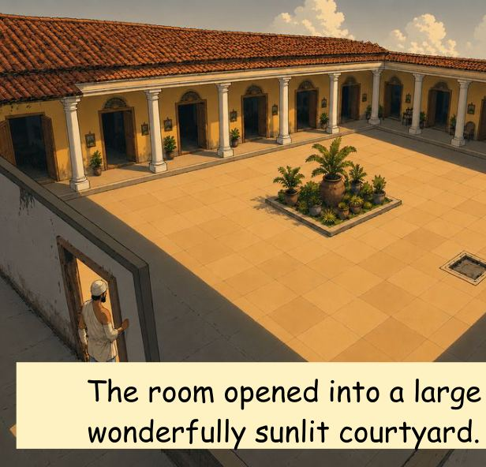

**b1-p004 panel 8.** A study crowded to the ceiling with books, specimen jars and loose papers, a long-necked stringed instrument propped by the window and a bronze figure on a stand. He steps in through the open door, barefoot, his bandaged arm held close.

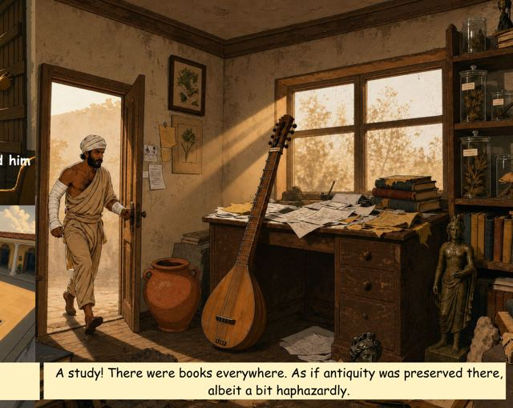

**b1-p004 panel 10.** The study again, from the doorway. He lies collapsed face down on the floor among scattered papers and a toppled pot.

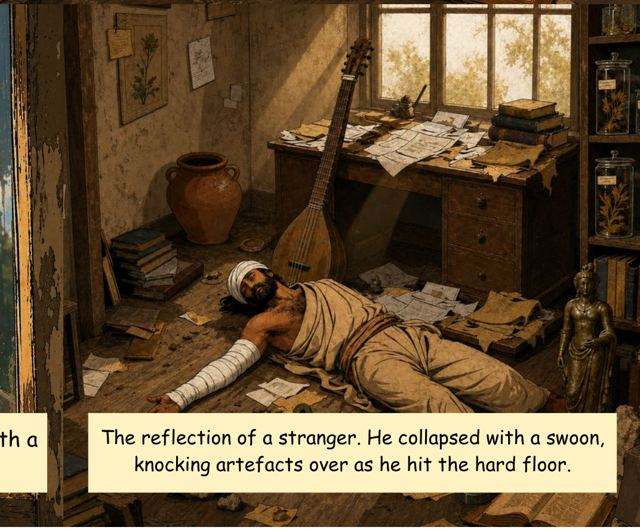

**b1-p005 panel 1.** The lodge in high summer: a low tiled-roof house behind a parched lawn and a row of tall pale trunks, the sun burning white overhead. The Professor kneels in the dust settling a sapling into a bed of flowers.

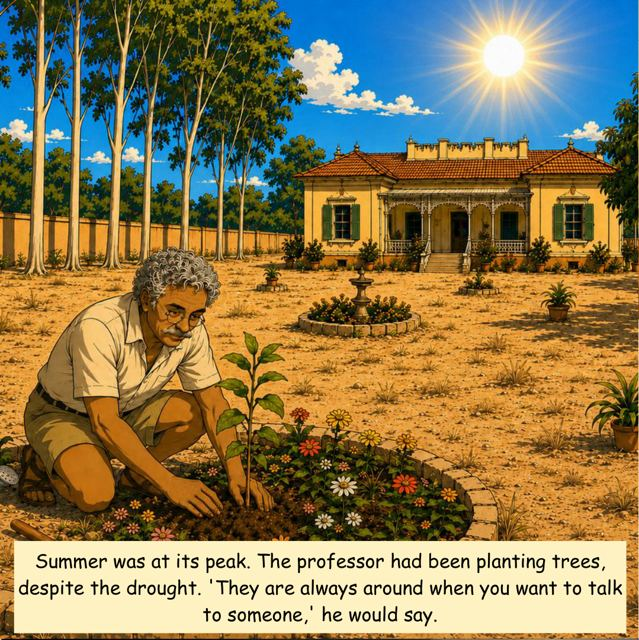

**b1-p006 panel 1.** The moustached man holds a rolled scroll out in both hands; beside him the ascetic stands bare-chested in white, the sun flaring behind the lodge roof.

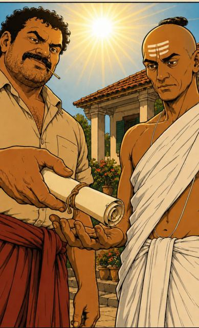

**b1-p006 panel 7.** Wide shot of the courtyard. The Professor walks away towards the steps of the lodge, his hat slung on his back; the ascetic, the moustached man and the stout man stand together watching him go.

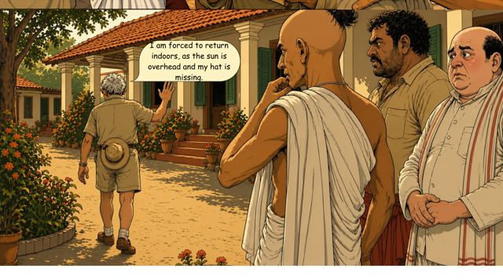

**b1-p007 panel 2.** In the study, the young man sits on the floor propped against a long-necked instrument while the Professor stands over him holding out a glass.

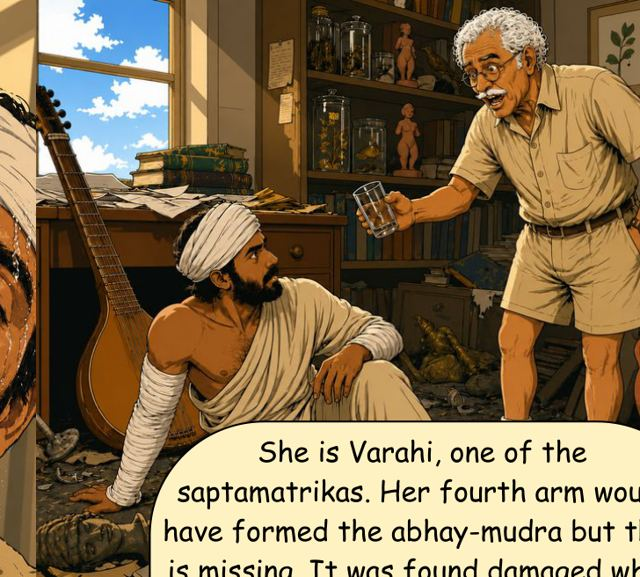

**b1-p007 panel 4.** The book-lined study. The man sits on the floor at the left; the Professor stands in the middle of the room holding the bronze figure up to the light.

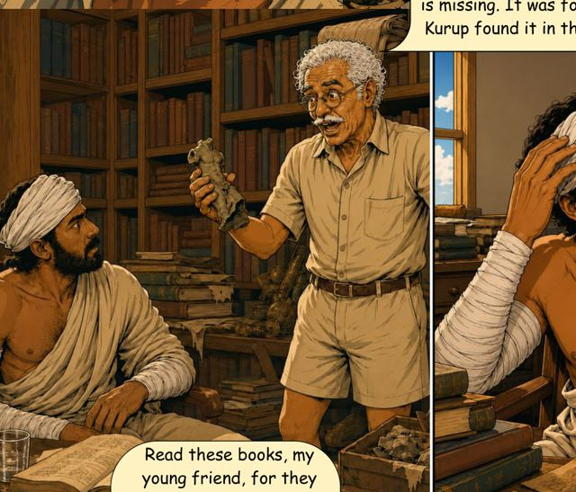

**b1-p007 panel 11.** The study again. The man has collapsed face down on the floor, a chair tipping over behind him, papers everywhere, the Professor lunging forward with both hands out.

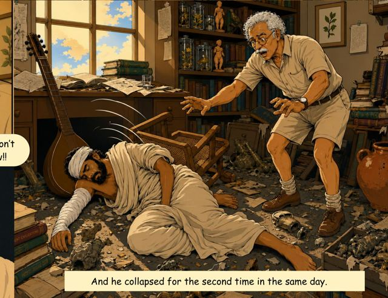

**b1-p008 panel 1.** Seen from behind, the man walks out along the veranda, head bandaged and his right forearm wrapped, into the glare of the dry garden.

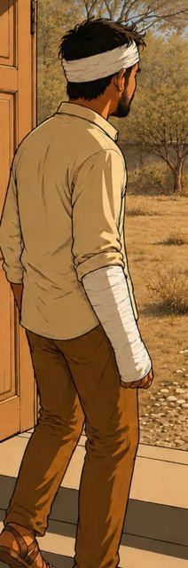

**b1-p008 panel 2.** The lodge from the road: a long white colonial house with a red tiled roof and a deep pillared veranda, seen through tall wrought-iron gates, its lawn burnt brown and potted plants set out along the drive.

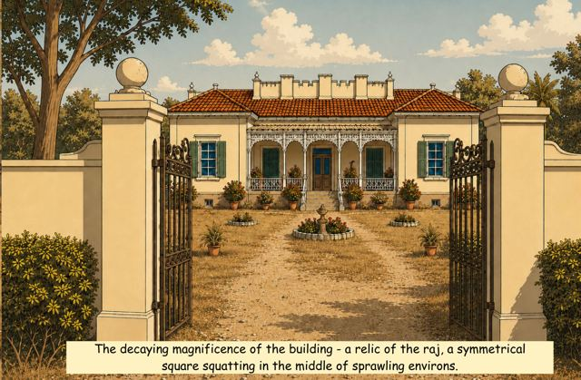

**b1-p008 panel 3.** He stands in the garden shading his eyes. Far down the drive, between the gateposts, a figure stands black against the low sun.

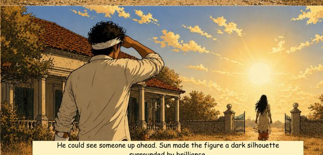

**b1-p008 panel 5.** Close: he leans over the well's parapet, his bandaged forearm flat on the stone, looking down the shaft.

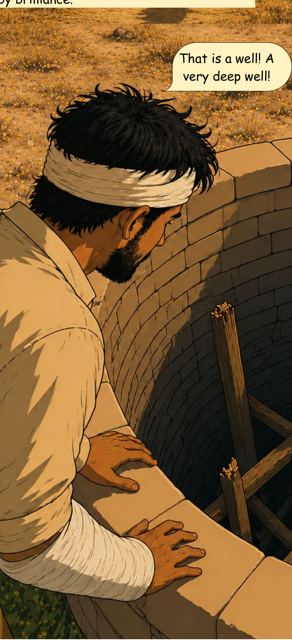

**b1-p008 panel 6.** The two of them by the well, the lodge behind. He stands with a hand out, talking; she balances barefoot along the rim.

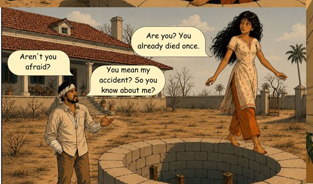

**b1-p009 panel 1.** He stands on the burnt lawn with a hand raised, explaining. She walks along the well's rim above him, looking away.

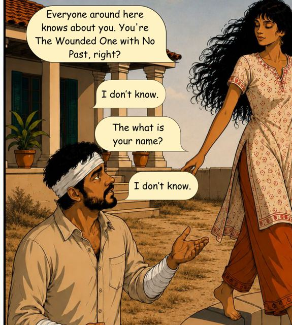

**b1-p009 panel 5.** He looks up at her from the grass while she stands barefoot on the rim of the well, the lodge and blue hills behind.

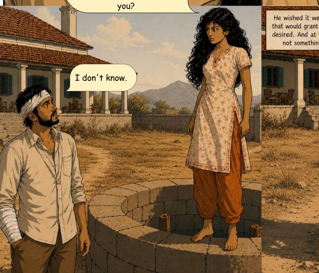

**b1-p009 panel 6.** He bends over the well and looks down into the water. Behind him she walks away towards the veranda.

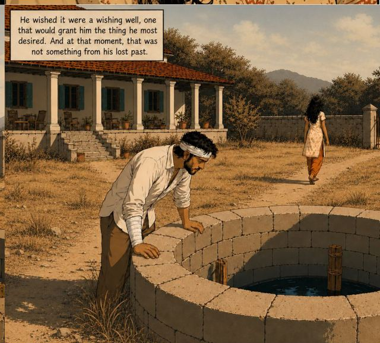

**b1-p010 panel 1.** From behind, he walks back towards the pillared veranda of the lodge.

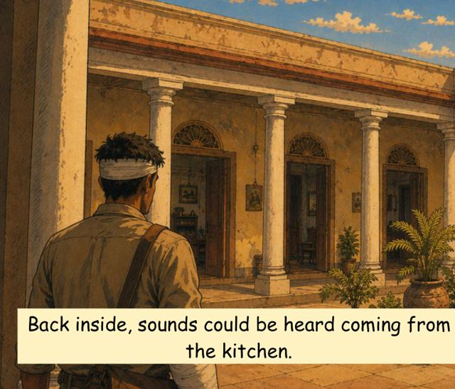

**b1-p010 panel 2.** The lodge kitchen. A stout cook in a white cap and a checked towel presses his palms together and bows; the young man stands at the worktop among jars and brass vessels, bright god-prints pinned to the wall behind.

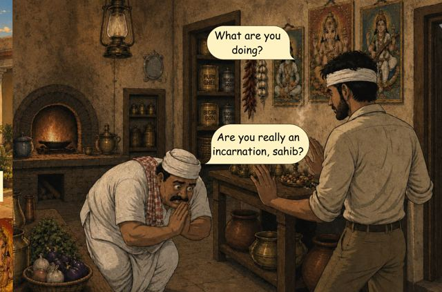

**b1-p011 panel 3.** The young man stands in the kitchen doorway looking out at a wall of blue mountains.

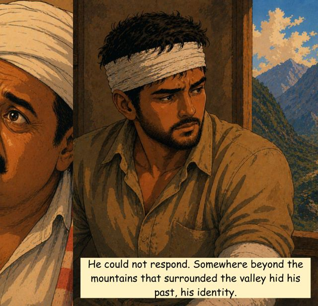

**b1-p012 panel 2.** The lodge lawn. The Professor sits in a cane chair with the young woman beside him; the young man walks towards them across the burnt grass.

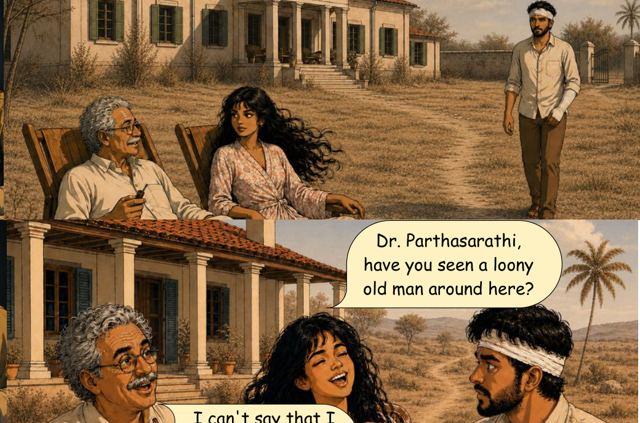

**b1-p012 panel 3.** The three of them on the veranda, the young woman laughing, the young man's arm in its sling.

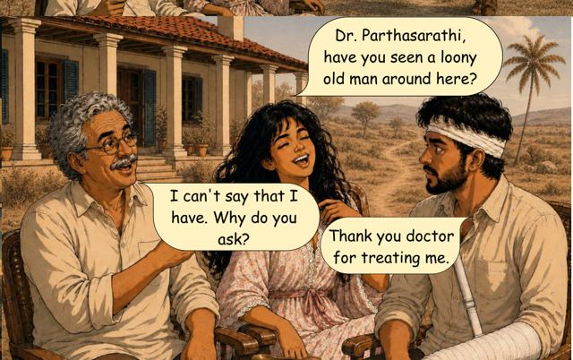

**b1-p012 panel 8.** The three of them on the veranda with their tumblers.

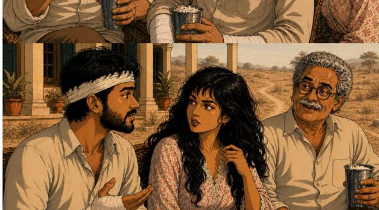

**b1-p021 panel 1.** The study. The Professor stands with a hand to his chest; Dvij sits at the left with his forearm grazed and bloodied; Bhavi is curled in a chair at the right in a green dress.

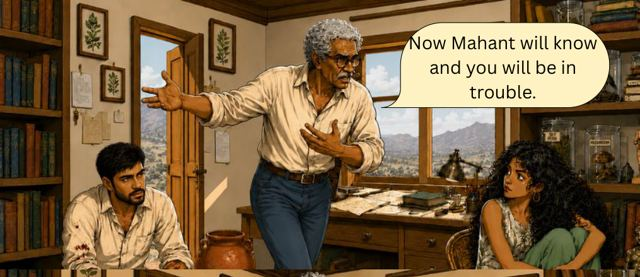

**b1-p022 panel 8.** A wide view of the study. A large hand-drawn map of the valley is spread across the table; Dvij leans over it on both fists, his grazed forearm showing. Bhavi throws her hands up at the left; the Professor stands at the right with one finger raised, mid-shout. On the floor is a book titled Architecture of the Vastu Shastra, and a jar of rudraksha beads on the shelf.

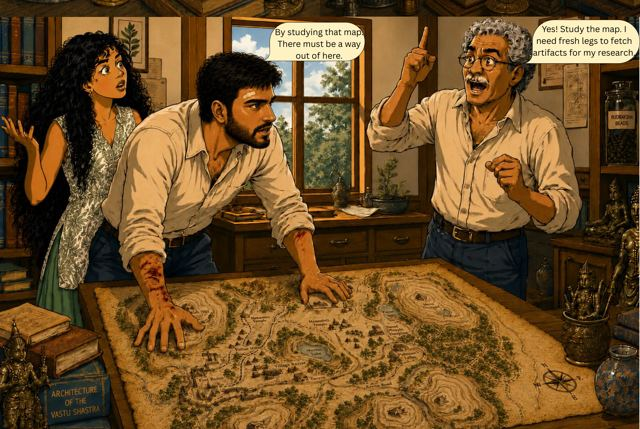

**b1-p023 panel 11.** Remembered frames stacked like photographs: children running in a garden, a family group, a man at the park gate. Bhavi stands in front of them.

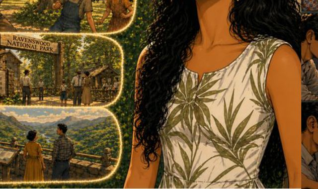

**b1-p029 panel 7.** A wide view of the open plateau beyond the gates: a small carved stone temple standing among scattered ruins, an orange flag on a pole, langurs sitting in a spreading tree. Dvij and Bhavi in the foreground.

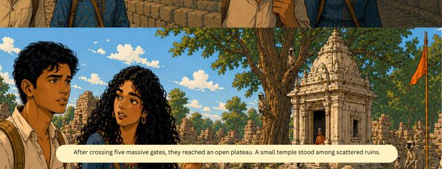

**b1-p033 panel 5.** The Mahavidya temples: ten carved spires of white, yellow and red crowded behind a low wall, the gate shut, a board in Hindi giving the hours. Dvij and Bhavi stand looking in.

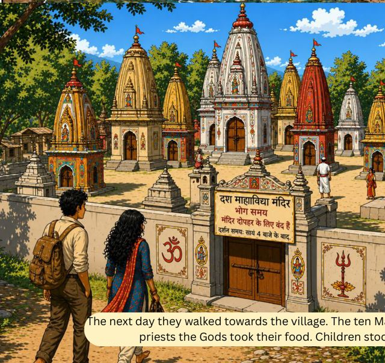

**b1-p036 panel 1.** A grand colonial bungalow standing derelict under a burning orange sky, its walls swallowed in creeper, windows black, the gateposts leaning. Dvij and Bhavi are small at the gate below.

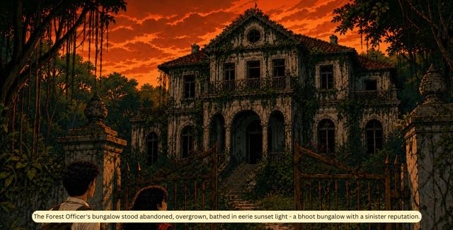

**b1-p038 panel 11.** Bhavi turning, then answering; Dvij with his finger still up, the chains and the night beyond the gate.

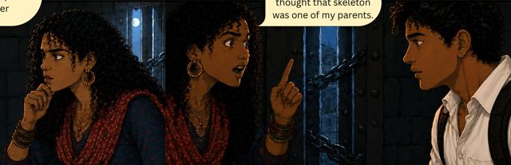

**b1-p039 panel 1.** The study. Dvij points across at Bhavi, who has come in wearing tall riding boots; the Professor sits at a board game he has been playing against himself.

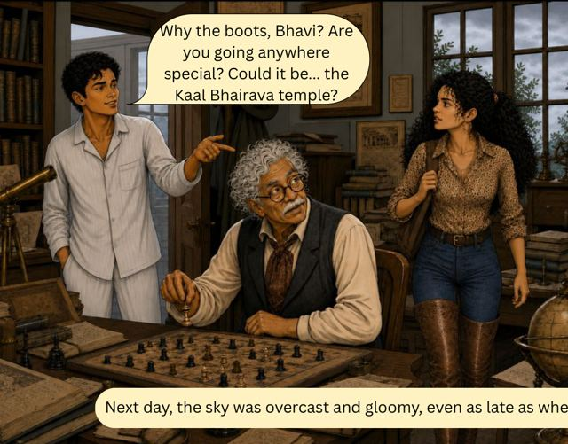

**b1-p039 panel 4.** Dvij and Bhavi walk out along the garden path towards the gate, arguing cheerfully.

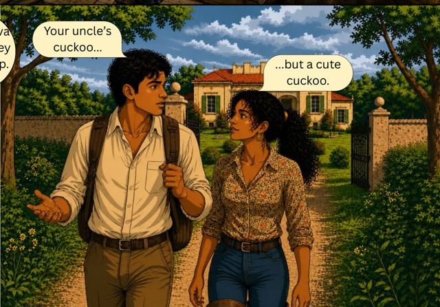

**b2-p001 panel 4.** The lodge seen from its wrought-iron gates, the drive running up between dry lawns. Dvij walks towards the veranda with Bhavi behind him.

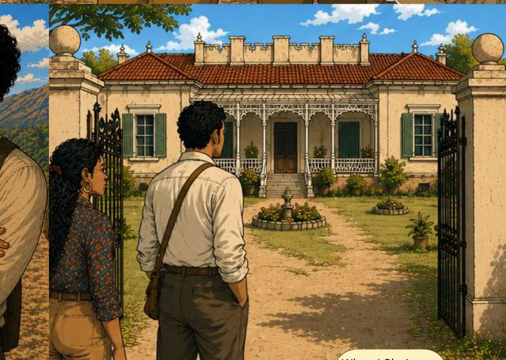

**b2-p001 panel 7.** Bhavi at the window. Beyond the curtain, out at the gate, the woman is standing quite still.

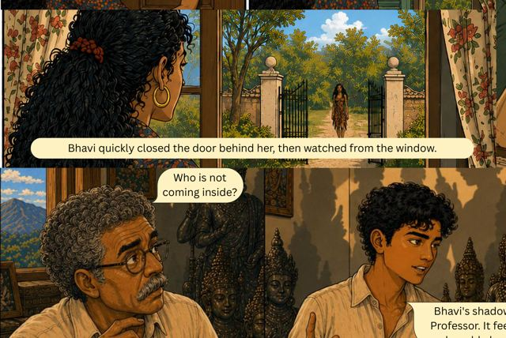

**b2-p003 panel 1.** Dvij at the left and the Professor at the right; between them a thought-cloud shows a saffron-robed messenger standing in a temple courtyard.

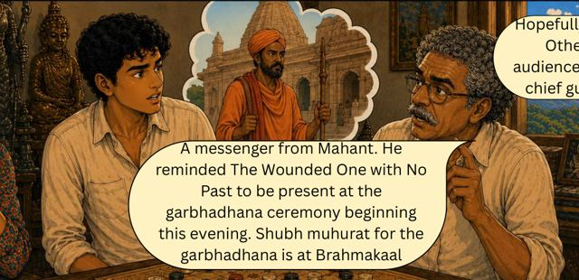

**b2-p010 panel 4.** The Professor puts a hand out to fend off a wall, Dvij slumped against his shoulder, a lamp burning on the gatepost behind.

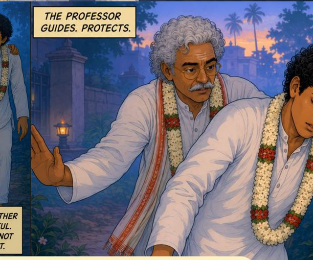

**b2-p011 panel 3.** The three of them in the study: Dvij at the left, the Professor in the middle with a coffee cup, Bhavi at the right against a wall of books, a globe and a brass armillary sphere.

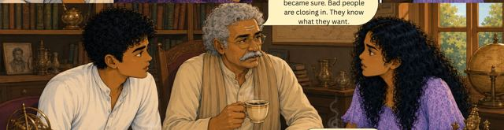

**b2-p012 panel 11.** Through the study door, the Professor walks out into the green garden with his hands clasped behind his back. Dvij and Bhavi watch him go from the table.

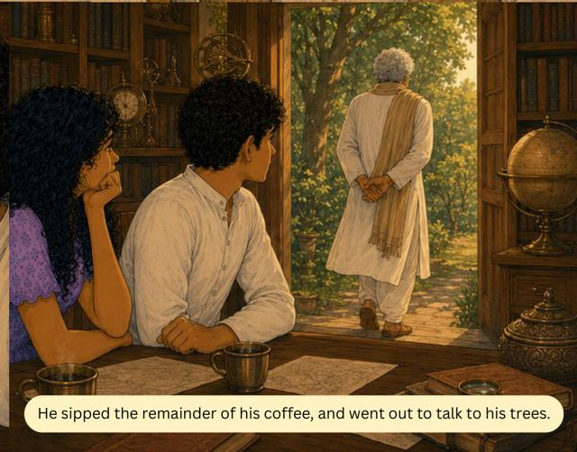

**b2-p016 panel 3.** The temple seen through its gateway: a great tiered stone spire above a wide wet courtyard, with a milkman carrying churns across the foreground. A technical drawing of the temple plan runs down the right edge.

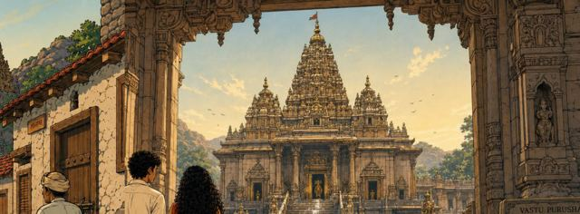

**b2-p018 panel 1.** In the temple compound a mahout on an elephant's neck sponges down its hide. Dvij and Bhavi walk past, talking; saffron-clad priests move away behind them, and the great gate tower rises over everything.

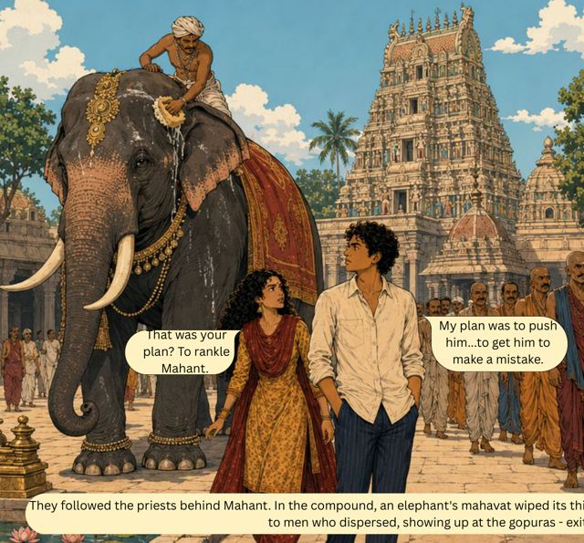

**b2-p018 panel 3.** The courtyard filling with people in dhotis and shawls.

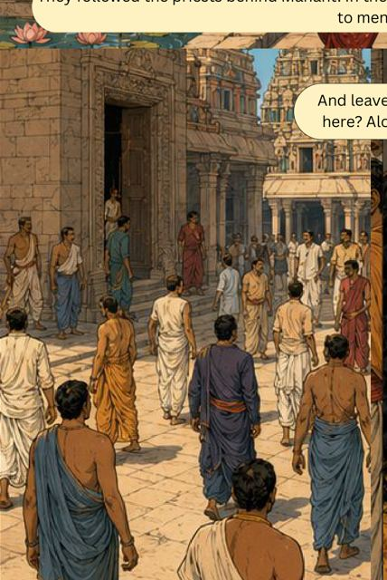

**b2-p018 panel 8.** CLAMOR! in big letters over the gate tower as people run in towards the entrance from every direction.

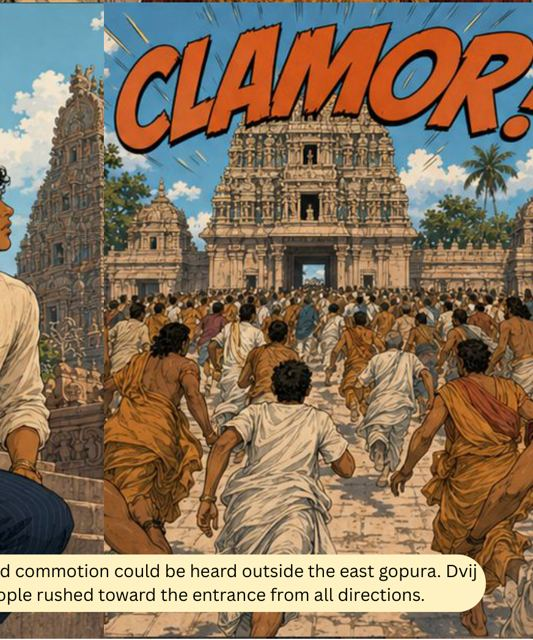

**b2-p027 panel 1.** Dvij and Bhavi walk up the track towards the lodge through dry woodland, the white house visible ahead between the trees.

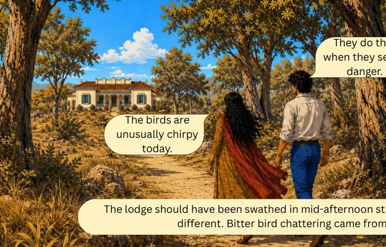

**b2-p027 panel 4.** The two of them break into a run up the drive towards the house.

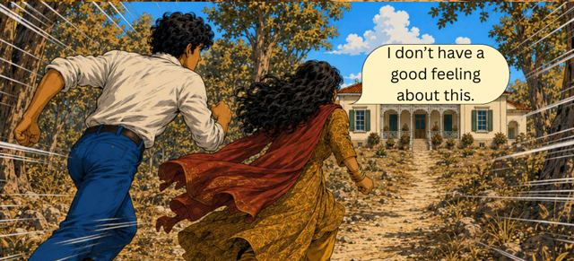

**b2-p027 panel 5.** They stop at the gate: the wrought-iron leaves are standing open.

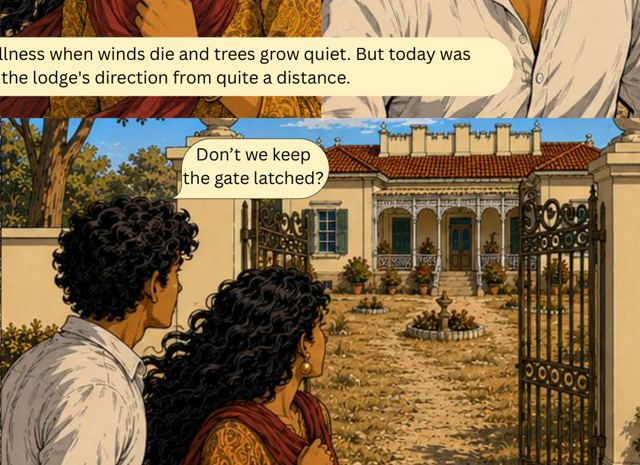

**b2-p027 panel 9.** Inside the study: the Professor slumped face down across the board game on his desk, one arm hanging. Bhavi stands frozen in the doorway.

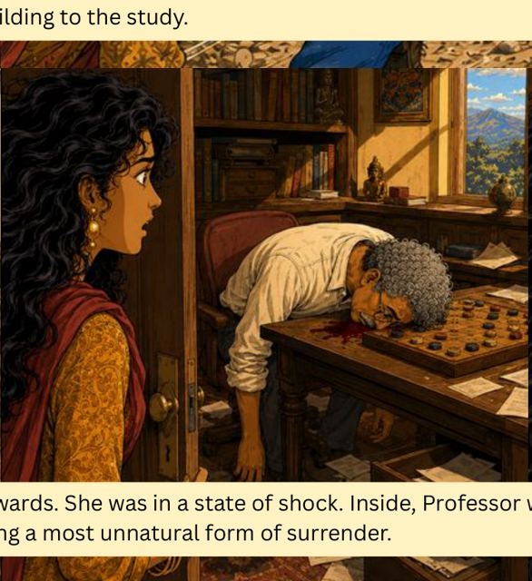

**b2-p033 panel 1.** Night. Two silhouettes slip away from the lit lodge across the dark grounds under a gibbous moon.

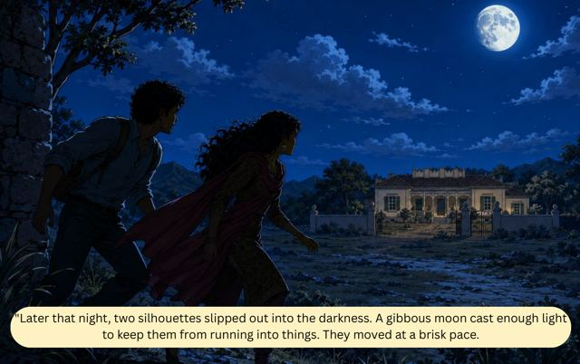

**b2-p033 panel 10.** Two figures walking away across the dark valley towards the lit windows of the lodge, the moon above.

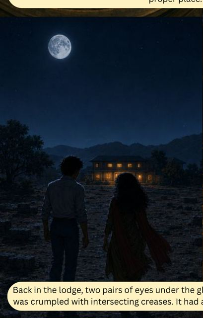

**b2-p033 panel 11.** Back in the study under the lamp: Dvij and Bhavi bent over the unfolded parchment, its creases showing, the line drawings spread across it. The Professor sleeps on the couch behind them.

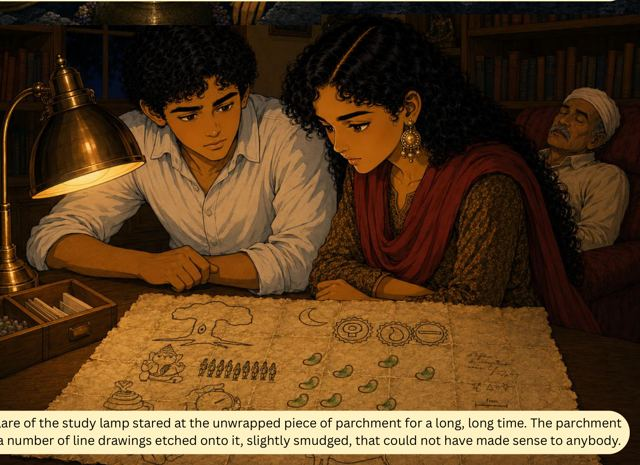

**b3-p001 panel 1.** Morning in the study. Bhavi is asleep face down on the desk over the parchment and an open book; Dvij bends over her.

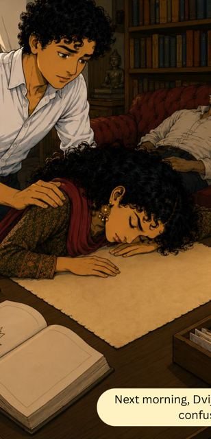

**b3-p009 panel 1.** The three of them run through the lit courtyard past the cook, who nearly drops his brass pot.

**b3-p010 panel 3.** All three break into a run past the kitchen doorway, where the cook sits stoking his stove in peace.

**b3-p016 panel 6.** The study settles into work: Dvij sprawled upside down over the arm of a chair with a sheet held above his face, Bhavi curled in the sofa reading, Kurup cross-legged on the floor. Small sound words drift about - whistle, sigh, cough.

**b3-p016 panel 8.** Dvij upside down on the chair with a sheet; beside him a drawn plan showing eight small buildings arranged in two overlapping squares, an arrow turning them into the elevation of the lodge's back wall. Bhavi glares from her chair; Kurup looks up from the floor.

**b3-p018 panel 4.** Dvij's feet crossing the rug; then Dvij with a finger raised, naming it - iconography, the study of symbols.

**b3-p020 panel 10.** Outside the lodge gates: Dvij and Bhavi walk away down the track while the yogini in her leopard-print wrap comes through the trees behind them.

**b3-p021 panel 2.** Inside the temple: a gilded gateway to the inner shrine where a vertical eye-shaped lingam stands garlanded in the dark. Dvij and Bhavi walk in past hanging lamps; a priest half dozes beside the offering bowl.

**b3-p023 panel 1.** A measured elevation drawing: the sanctum, the pillared hall, a tall lamp column and the gateway tower, with a dashed sight line running through them and a caption asking whether the hole aligns with the dhwajastambha and beyond.

**b3-p023 panel 3.** Outside: a tall brass-clad lamp column with a flag at its top, the beam of light striking it, the gateway tower beyond.

**b3-p023 panel 9.** From inside the porch: the monolithic Nandi bull on its plinth, the lamp column, the golden gateway tower - and behind everything, an enormous mountain filling the sky at sunset. Dvij, Bhavi and Kurup stand looking out at it.

**b3-p027 panel 12.** The procession walks back towards the lit windows of the lodge: Dvij, Kurup with a roti held up, Ponga shuffling after it, and the yogini alongside.

**b3-p028 panel 4.** A dark corridor of the lodge with a lamp at the far end; Bhavi in the foreground saying they must go before the Mahant does.

**b3-p029 panel 7.** Night outside the lodge: Bhavi stands in the lit doorway, Kurup walks off towards the shed, and Dvij steps out onto the gravel path as the last light goes out. The mountain stands black against the sky.

**b3-p030 panel 1.** The lodge gates under a full moon. Dvij walks down the drive; the yogini crouches by the gatepost in the dark.

**b3-p030 panel 4.** Dvij comes to the gate and puts out his hand; the yogini crouches at his feet.

**b3-p030 panel 12.** Dvij steps out into the courtyard and wipes his forehead, relieved.

**b3-p030 panel 14.** Across the courtyard, Ponga sprawled asleep on the flagstones, snoring, with musical notes floating over him.

**b3-p031 panel 1.** The lodge from above at night: a courtyard house round a planted square, its rooms lit one by one - Ponga asleep on the flagstones, the yogini in a doorway, a single lamp burning behind one shutter.

**b3-p033 panel 6.** The two of them walking out into the night, the gate ahead, stars overhead.

**b3-p033 panel 8.** The gravel path and the creaking gate behind them - and below, the town at night with a river of lamps winding up through it to a lit temple tower.

**b4-p001 panel 1.** Morning chaos in the lodge: Dvij crouched over a half-packed bag, Ponga squatting among the clutter, Kurup stooping at the back, the yogini in the doorway.

**b4-p001 panel 2.** Dvij and Bhavi, now in a rust-red shirt, stand before a wall of framed god-prints - Ganesha at the centre - with a lamp burning beneath them and brass vessels on the shelves.

**b4-p001 panel 6.** The party walks out through the lodge gates with packs on their backs - Dvij, Bhavi, Kurup, Ponga and the yogini - looking back at the house.

**b4-p003 panel 8.** The flashback proper: on the lodge lawn the Professor flings an arm up towards the orange flag on the roof, telling Dvij the lodge is Arjuna's chariot and he is Parthasarathi waiting for a deserving Arjuna. Dvij stands listening, his head still bandaged.

**b4-p009 panel 6.** The Mahavidya temples: a dense cluster of carved stone spires behind a tall iron gate, orange flags on their finials, trees crowding between them. Bhavi stands with a hand on her hip asking why they are here; Dvij walks in through the gate.

**b4-p025 panel 3.** Three framed images: a bronze dancing figure on a museum stand, a portrait and a smaller statue in an interior, and the same figure standing among ruined pillars. Below, Dvij tells Bhavi across the table that the statue Kurup showed in the temple was not the one in the Professor's study - the mudras of the hands and feet differ - and that the other sits in the Mahant's stateroom, where he saw it while waiting.

**b5-p006 panel 5.** A second flashback, in the Professor's study: charts of the brain and a board comparing semantic memory - knowing how to drive a car, how to use a gun - with episodic memory, where and when you learned. The Professor lectures with books piled round him while Dvij listens.

**b5-p007 panel 6.** Bhavi, close, looking away, saying that when he was brought to the lodge he was still conscious despite all the blood he had lost.

**b5-p010 panel 8.** A chart on the wall of the four kalas of the day - morning practice, midday service and study, evening worship, night rest. Dvij thanks the sage, saying he now sees the world in a way he never had, but his mind remains restless and he will come and seek more.

**b5-p018 panel 9.** The Mahant's party filing out of the ashram gates in a column, heading away south. Bhavi says it looks as though he has worked it out - but why are they headed south?

